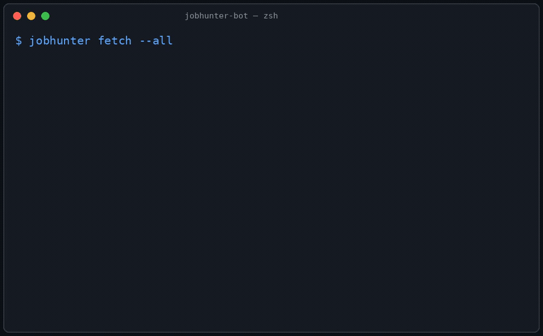
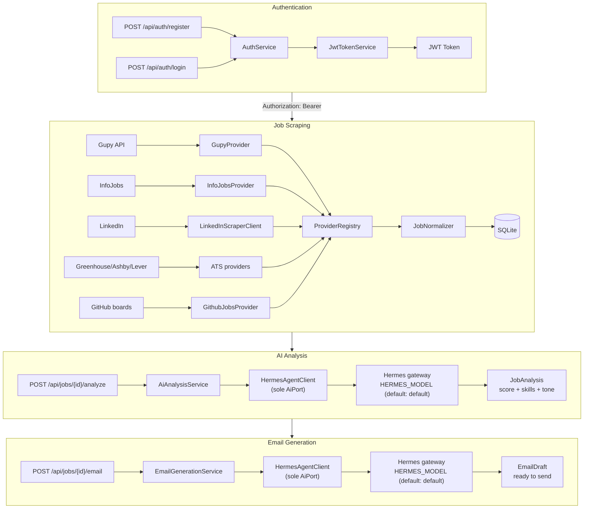
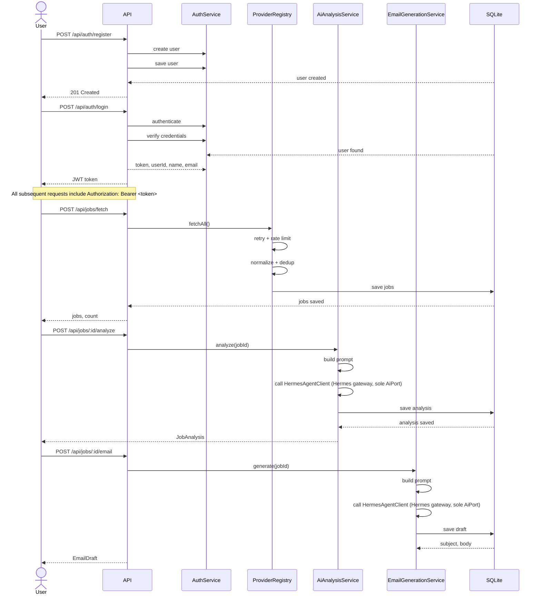
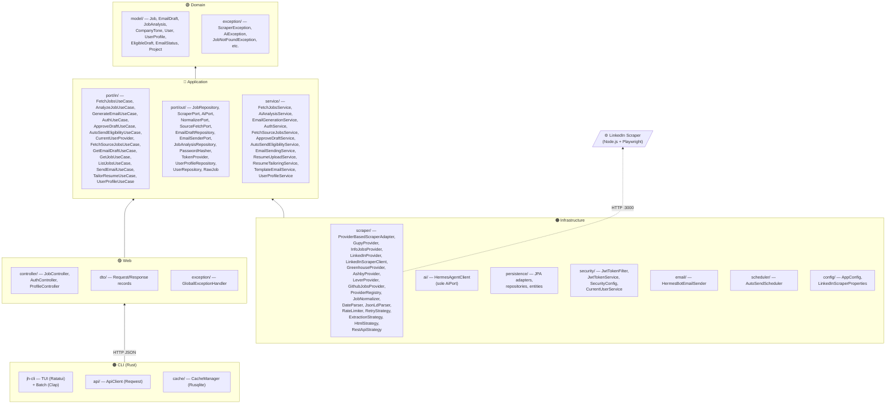
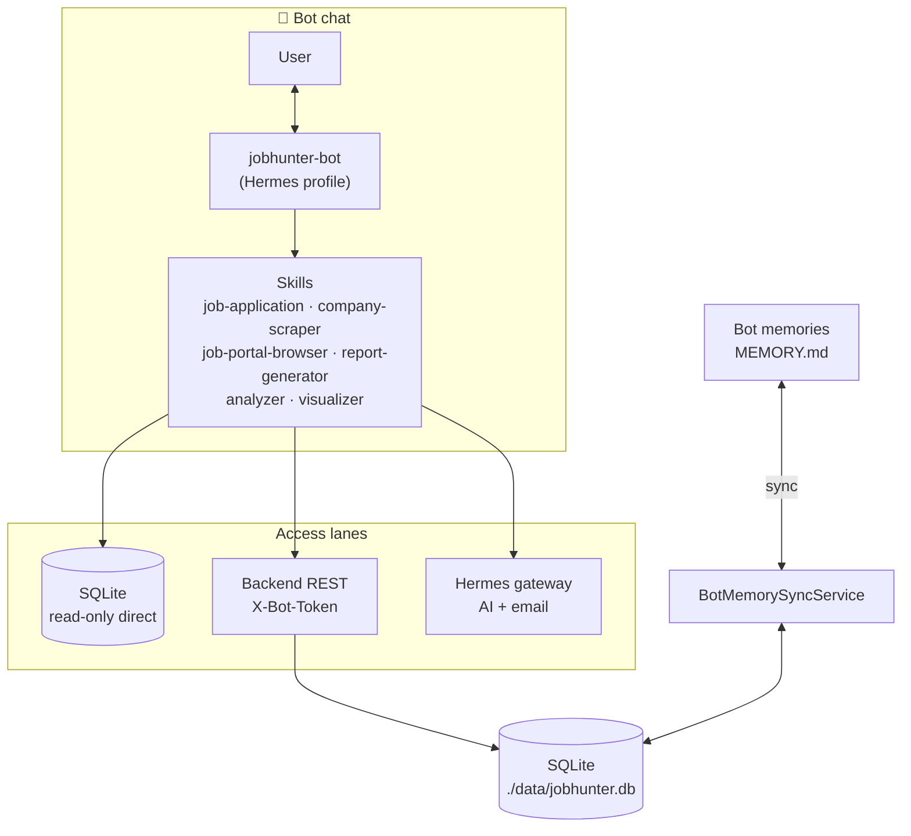
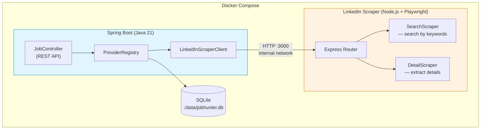
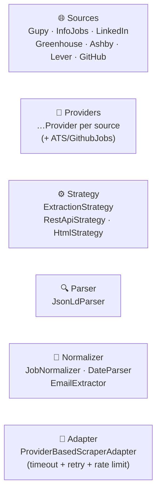

# Job Hunter

[](https://github.com/Uzzoper/job-hunter/actions/workflows/ci.yml)
[](https://github.com/Uzzoper/job-hunter/actions/workflows/cli-release.yml)


**Automated junior-developer job hunting, scored by AI, applied with your approval.**
Chat with the `jobhunter-bot` Hermes agent — it lists, analyzes, drafts emails, and applies for you.

For portfolio reviewers: the **Hermes bot** is the primary interface (see [ADR 001](docs/adr/001-multi-interface.md)). The Rust CLI/TUI is legacy (kept for debug/manual use).

---

## Demo



*Illustrative run: aggregate counters only — no real listings, companies, recipients or applications are shown.*

---

## How it works



0. Register or login via `/api/auth/register` and `/api/auth/login` to receive a JWT token.
   All subsequent requests must include `Authorization: Bearer <token>`.
   The bot lane uses a static service token instead: `X-Bot-Token: <secret>` (no `Bearer`) — see `bot.service` in `application-local.yaml` and `scripts/setup-bot-access.sh`. CLI/webapp keep JWT login.
1. The scraper fetches job listings from Gupy, InfoJobs, LinkedIn, Greenhouse/Ashby/Lever boards and GitHub community boards, filtered by keywords.
2. Each listing is saved to SQLite (`./data/jobhunter.db`) — duplicates are skipped by URL.
3. On demand, the AI analyzes the listing against your profile and returns a match score (0–100), matched/missing skills, and company tone. The score also reflects your saved work preferences (remote/hybrid/onsite, salary floor, excluded companies) — deterministically and in the prompt.
4. The AI then generates a personalized application email in Brazilian Portuguese for jobs scoring at or above the threshold (`email.standard-template.min-match-score`, default 60), tailored to the company tone and mentioning a relevant portfolio project. Below the threshold the standard template (or a refusal for incompatible jobs) is used instead.
5. Optionally, the auto-send scheduler sends emails in priority order (highest matchScore first). Requires manual approval by default and respects a daily cap of 50/user.
6. Alternatively, the `jobhunter-bot` Hermes profile applies for you conversationally: it picks top-scored jobs from the API, drives the portal (Gupy/InfoJobs) through a Playwright MCP loop with confirmation checkpoints, and records `applied` only after a verified submit — never on plan time.

---

## Getting started

### Prerequisites

- Java 21
- A local **Hermes Agent** bot profile (gateway on localhost:8642 — see 'Email sending via Hermes Agent' below). `HERMES_API_KEY` is the only AI credential required; Hermes also handles email delivery
- Rust 2024 edition (for the CLI binary — `curl --proto '=https' --tlsv1.2 -sSf https://sh.rustup.rs | sh`)
- Docker + Docker Compose (optional — only to run the LinkedIn scraper container; the database needs none)

### Setup

**1. Clone the repository**

```bash
git clone https://github.com/Uzzoper/job-hunter.git
cd job-hunter
```

**2. Database — nothing to do**

The backend uses an embedded SQLite file (`./data/jobhunter.db`, overridable via `DB_URL`).
Flyway creates the file and the schema automatically on first startup — no server, no container.

**3. Create the local configuration file**

Create `src/main/resources/application-local.yaml`:

```yaml
jwt:
  secret: a-key-with-at-least-32-characters-for-hmac

hermes:
  base-url: http://127.0.0.1:8642/p/jobhunter-bot/v1   # OpenAI-compatible API root; clients append /chat/completions
  api-key: YOUR_HERMES_API_KEY   # equals the gateway API_SERVER_KEY — required
  model: default                 # HERMES_MODEL: model pinned on the Bot profile
  timeout-seconds: 120

bot:
  service:
    # Static service token for bot API access (issue #47): the bot sends it
    # via the X-Bot-Token header (no Bearer — CLI/webapp keep JWT login).
    # Blank api-key disables the feature. Same value goes in the bot profile
    # as api-token.txt.
    api-key: ${BOT_SERVICE_API_KEY}
    owner-user-id: ${BOT_SERVICE_OWNER_USER_ID}   # existing user the bot acts as
```

> This file is in `.gitignore` and will never be committed.

### Email sending via Hermes Agent (required for `POST /api/jobs/{id}/send`)

Application emails are delegated to a [Hermes Agent](https://hermes-agent.nousresearch.com)
bot. Full setup (profile creation, himalaya, Gmail app password, gateway keys,
smoke test, service install): [`docs/bot-onboarding.md`](docs/bot-onboarding.md).

Quick version:

1. Install Hermes Agent and create a profile: `hermes profile create jobhunter-bot --clone-all`
2. Give the profile an email tool (himalaya CLI v2) and set `API_SERVER_KEY` in the profile `.env`
3. Set `approvals.mode: off` in the profile's `config.yaml`
4. Export `HERMES_API_KEY=YOUR_HERMES_API_KEY` before running job-hunter

The same gateway is the sole AI backend for analysis and email generation
(`hermes.base-url` must end in `/v1` — the clients append `/chat/completions`).

#### Bot setup from scratch

The steps above assume a working bot profile. Starting from zero, follow
[`docs/bot-onboarding.md`](docs/bot-onboarding.md) — it is the single source
for profile creation, himalaya config, Gmail app password, gateway keys, smoke
test and service install. The README keeps a short quickstart only.

**4. Run the application**

```bash
./mvnw spring-boot:run -Dspring-boot.run.profiles=local
```

The application starts on `http://localhost:8080`. Flyway creates the database
schema automatically.

**5. LinkedIn scraping (optional)**

```bash
docker compose up -d linkedin-scraper
```

Then set `scraper.linkedin.service-url: http://localhost:3000` in
`application-local.yaml`.

> Without this, Gupy and InfoJobs still work (no container needed). LinkedIn
> falls back to Jsoup (`scraper.linkedin.mode: jsoup`).

**6. Build and run the CLI (legacy)**

```bash
cd cli && cargo build --release && ./target/release/jh-cli --help
```

> The Rust CLI/TUI is legacy — daily use goes through the Hermes bot. See
> [`docs/cli.md`](docs/cli.md) for batch commands.

---

## Hermes bot (primary interface)

Per [ADR 001](docs/adr/001-multi-interface.md), the Hermes Agent bot
(`jobhunter-bot` profile) is the primary interface: you chat, it
lists/applies/reports via skills. **Start at
[`docs/bot-onboarding.md`](docs/bot-onboarding.md)** — the step-by-step guide
from fresh clone to working integration.

```bash
bash scripts/install-bot-skills.sh                # install skills into the bot profile
bash scripts/setup-bot-access.sh --owner-id <id>  # service-token setup (X-Bot-Token)
```

Skills: `company-scraper` (company contact research), `job-application` (Gupy +
InfoJobs apply planner), `job-portal-browser` (browser fallback),
`report-generator` + `analyzer` + `visualizer` (progress reports and funnel
charts). Standing-instructions template: `bot-profile/SOUL.md` (installed once,
never overwritten).

Watch the bot work live and take over logins/CAPTCHAs via the official Hermes
**Bot Screen**: setup, takeover flow, standing LinkedIn rules and troubleshooting
are in [`docs/specs/bot-screen-runbook.md`](docs/specs/bot-screen-runbook.md).

---

## CLI / TUI (legacy)

The project includes a **Rust** binary (`jh-cli`) with two interaction modes.
Marked **legacy** — daily use goes through the Hermes bot. Kept for debug and
manual JWT access.

| Mode | Trigger | Description |
|------|---------|-------------|
| **TUI** (default) | No subcommand or `-T`/`--tui` | Interactive terminal UI |
| **Batch** | Any subcommand | Non-interactive commands for scripting and CI |

Batch commands are documented in [`docs/cli.md`](docs/cli.md).

> Full spec at [`docs/specs/cli-tui-spec.md`](docs/specs/cli-tui-spec.md)


## API

| Method | Endpoint | Description | Auth Required |
|--------|----------|-------------|:---:|
| `POST` | `/api/auth/register` | Register a new user | No |
| `POST` | `/api/auth/login` | Login and receive JWT token | No |
| `GET` | `/api/jobs?hasEmail=&excludeApplied=&minScore=` | List jobs (filters: has contact email, hide applied, minimum AI score; each item carries draftStatus + matchScore) | Yes |
| `GET` | `/api/jobs/{id}` | Get job detail | Yes |
| `POST` | `/api/jobs/fetch` | Trigger all scrapers (all registered providers) | Yes |
| `POST` | `/api/jobs/fetch/linkedin` | Trigger only LinkedIn scraper | Yes |
| `POST` | `/api/jobs/fetch/gupy` | Trigger only Gupy scraper | Yes |
| `POST` | `/api/jobs/fetch/infojobs` | Trigger only InfoJobs scraper | Yes |
| `POST` | `/api/jobs/fetch/lever` | Trigger only Lever scraper | Yes |
| `POST` | `/api/jobs/{id}/analyze` | Analyze job with AI | Yes |
| `GET` | `/api/jobs/{id}/email` | Get generated email draft | Yes |
| `POST` | `/api/jobs/{id}/email` | Generate new email for the job | Yes |
| `POST` | `/api/jobs/{id}/email/approve` | Approve a PENDING draft for auto-send | Yes |
| `POST` | `/api/jobs/{id}/send` | Send email via Hermes bot using user's email as from | Yes |
| `POST` | `/api/jobs/{id}/applied` | Record an external application (201 when created) | Yes |
| `POST` | `/api/jobs/{id}/resume` | Generate ATS-tailored resume PDF for the job | Yes |
| `GET` | `/api/profile` | Get authenticated user's profile (includes preferences: workPreference, salaryFloor, excludedCompanies) | Yes |
| `PUT` | `/api/profile` | Save/update user profile | Yes |
| `POST` | `/api/profile/upload-resume` | Upload PDF resume → AI extracts skills & projects | Yes |

### Full API Flow



---

## Tech stack

| Layer | Technology |
|---|---|
| Language | Java 21 / Rust 2024 |
| CLI Framework | Rust + Clap + Ratatui + Crossterm |
| HTTP Client (CLI) | Reqwest (Rust) |
| Local Cache | SQLite via Rusqlite (Rust) |
| Framework | Spring Boot 4.0.6 |
| Architecture | Clean Architecture |
| Database | SQLite (local file — no server, no Docker) |
| Migrations | Flyway |
| Security | Spring Security + JWT (jjwt) |
| Scraping | RestClient + Jsoup |
| Browser Automation | Playwright (Node.js + TypeScript, separate container) |
| AI | Hermes Agent gateway (OpenAI-compatible) — sole provider |
| Tests | JUnit 5 + Mockito + WireMock / Rust async tests |
| Build | Maven / Cargo |

---

## Architecture

This project follows Clean Architecture with strict layer separation:



The dependency rule is strictly enforced: `domain` has no external dependencies, `application` depends only on `domain`, and `infrastructure`/`web` depend on `application`.

### Bot as interface



The bot reaches the backend through the `X-Bot-Token` lane, reads SQLite directly for reporting skills, and uses the Hermes gateway for AI/email. Preferences flow both ways via `BotMemorySyncService` (bot memories ↔ backend, see `docs/bot-onboarding.md` §6).

---

## Docker Architecture

The LinkedIn scraper runs as a separate container — a deliberate architectural decision to keep responsibilities isolated:



The Spring Boot container handles business logic, orchestration, and persistence. The Node.js container handles browser automation exclusively. Containers communicate via Docker's internal DNS (`http://linkedin-scraper:3000`); the scraper's port `3000` is also published to the host, so a natively-run backend can reach the containerized scraper via `http://localhost:3000` (see Getting started).

> The backend container runs as UID 1000. Before `docker compose up`, pre-create the data
> directory (`mkdir -p data`) so the bind mount is owned by your user — otherwise Docker
> creates it as root and the container cannot write the SQLite file.

---

## Scraping Pipeline



Each source is wrapped by a **Provider** that selects the right **Strategy** (REST API vs HTML). The parsed result is **Normalized** (dates, URLs, work model, contact emails, null-safe fields) and **Deduplicated** by URL before reaching the database via the **Adapter** (per-provider timeout budget, exponential-backoff retries, token-bucket rate limiting).

> **Note**: LinkedIn follows a different path — a dedicated Node.js + Playwright microservice handles browser automation and feeds data through `LinkedInScraperClient` into the same normalization pipeline. ATS boards (Greenhouse/Ashby/Lever) and GitHub community boards are plain-HTTP providers (no key, no scraping) gated by `ats.enabled` / `github.enabled` (both default `false` until the junior-relevance sample sign-off).

---

## Running the tests

```bash
# Backend (Java)
./mvnw test

# CLI (Rust)
cd cli && cargo test

# LinkedIn microservice (Node.js)
cd linkedin-scraper && npm test
```

The Java test suite uses WireMock to simulate HTTP servers for the scraper and AI client — no real API calls are made during testing. The Rust CLI uses `httpmock` for the same purpose. The LinkedIn microservice has its own Jest test suite with Playwright fixtures.

---

## Development methodology

This project was built following **SDD (Specification-Driven Development)** and **TDD (Test-Driven Development)**:

- Every feature starts with a spec in `docs/specs/` (Given/When/Then)
- Tests are written before the implementation (RED → GREEN → REFACTOR)
- The AI coding assistant is guided by `AGENTS.md`, which documents the architecture, conventions, and workflow

---

## Project structure (docs)

```
docs/
├── adr/
├── bot-onboarding.md
└── specs/
    ├── _template.md
    ├── analyze-job.md
    ├── angular-frontend-spec.md
    ├── answer-policy.md
    ├── architecture.md
    ├── async-company-enrichment.md
    ├── ats-provider.md
    ├── ats-resume-tailoring.md
    ├── auto-send-scheduler.md
    ├── bot-company-enrichment.md
    ├── bot-memory-sync.md
    ├── bot-screen-runbook.md
    ├── cli-auth-ux-fixes.md
    ├── cli-fetch-ux.md
    ├── cli-tui-spec.md
    ├── consistency-audit.md
    ├── contact-email-extraction.md
    ├── deduplicate-jobs.md
    ├── deterministic-apply-runbook.md
    ├── email-enrichment.md
    ├── email-idempotency.md
    ├── email-no-apply-refusal.md
    ├── fetch-jobs.md
    ├── generate-email.md
    ├── github-actions-ci.md
    ├── github-jobs.md
    ├── gupy-scraper.md
    ├── hermes-agent-integration.md
    ├── hermes-only-ai.md
    ├── indeed-scraper.md
    ├── infojobs-scraper.md
    ├── job-application-auth-loop.md
    ├── linkedin-scraper-client.md
    ├── linkedin-scraper-service.md
    ├── list-jobs-filter.md
    ├── match-quality.md
    ├── mcp-apply-loop.md
    ├── preferences-scoring.md
    ├── profile-autofill-from-resume.md
    ├── profile-placeholders.md
    ├── prompts.md
    ├── resume-upload.md
    ├── send-email.md
    ├── sqlite-local-persistence.md
    ├── template-email.md
    ├── tui-has-email-filter.md
    ├── use-case-refactoring.md
    ├── user-authentication.md
    ├── user-preferences.md
    ├── user-profile.md
    └── user-scoped-analysis.md
```

---

## License

This project is licensed under the **GNU General Public License v3.0**. See the [LICENSE](LICENSE) file for details.

## Author

**Juan Peruzzo**
[juanperuzzo.is-a.dev](https://juanperuzzo.is-a.dev) · [GitHub](https://github.com/Uzzoper)
